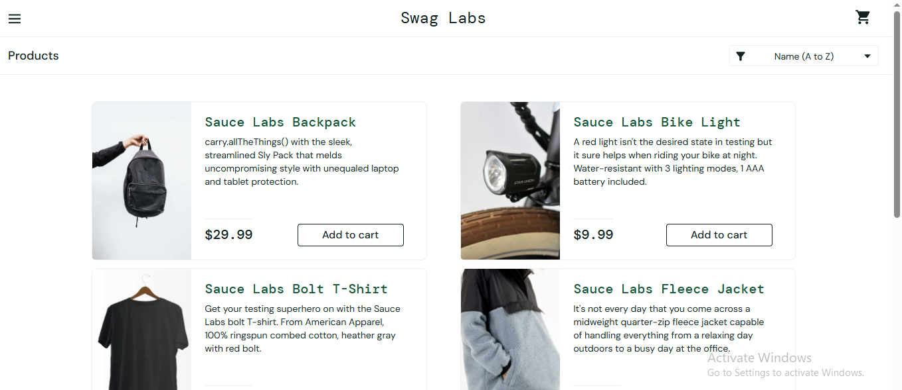
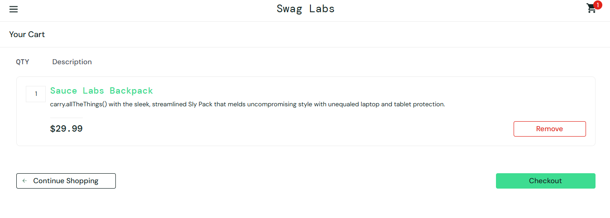

# SauceDemo — Manual Testing Portfolio

A practical manual QA project covering the login, product listing and shopping cart workflows of the SauceDemo sample e-commerce application.

## Project objective
Document and execute positive and negative functional test cases, compare expected and actual behavior, and organize execution evidence for traceability.

- **Application:** [SauceDemo](https://www.saucedemo.com/)
- **Browser:** Google Chrome (version not recorded)
- **Testing approach:** Manual functional testing, positive and negative scenarios, input validation
- **Documentation:** Microsoft Excel and Markdown

## Deliverables

| File | Description |
|---|---|
| [SauceDemo_Test_Cases.xlsx](SauceDemo_Test_Cases.xlsx) | Nine documented test cases with steps, inputs, expected and actual results, status and priority |
| [Test_Summary.md](Test_Summary.md) | Execution summary, evidence links and limitations |
| [screenshots/](screenshots/) | Eleven original screenshots covering all nine test cases |

## Results

| Total cases | Passed | Failed | Cases with screenshots |
|---:|---:|---:|---:|
| 9 | 9 | 0 | 9 |

Results are based on the original Lab 1 execution record. The locked-out user bonus scenario is counted as TC009. All nine cases now have supporting screenshots. The price-sorting screenshots show the selection step and the first four products in ascending price order; the original lab records the overall sorting result as Pass.

## Example execution evidence

### TC001 — Successful login

### TC006 — Shopping cart contents

For the full test-to-evidence mapping, see the [test summary](Test_Summary.md).

## Future improvements
- Capture the full sorted product list in a future run for more complete sorting evidence.
- Investigate potential error-message clipping seen in the invalid-password screenshot.
- Extend coverage to checkout and other high-value user flows.
- Automate selected regression cases using Selenium WebDriver.

This is a learning and portfolio project using a public demo application, not a production assessment or an official Sauce Labs project.
